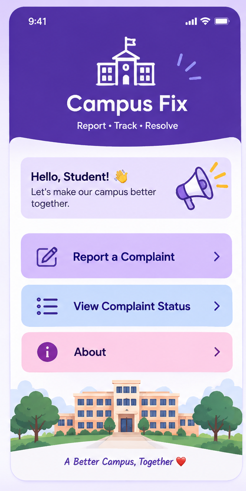
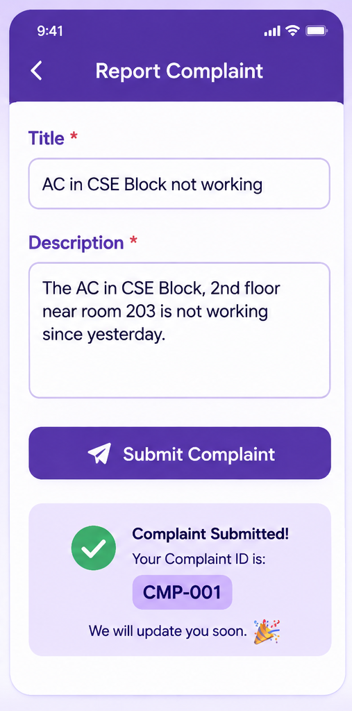
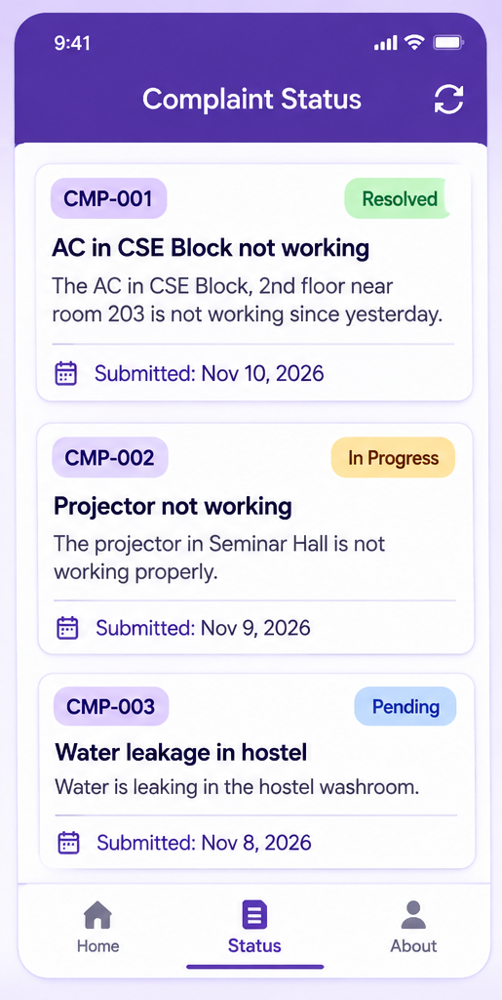

# Campus Fix

A Flutter app for reporting and tracking campus complaints.

## Features
- Home screen with easy navigation
- Report a complaint with title and description
- View the status of submitted complaints
- Shared state management using Provider

## Screenshots

| Home | Report Complaint | Complaint Status |
|------|------------------|------------------|
|  |  |  |

## Tech Stack
- Flutter (Dart)
- Provider (state management)
- uuid (unique complaint IDs)

## How to Run
1. Clone the repo:
   `git clone https://github.com/srivallikakurimindla-bot/Campus_Fix.git`
2. Go into the folder: `cd Campus_Fix`
3. Install packages: `flutter pub get`
4. Run the app: `flutter run`

## Author
K. Srivallika

## Future Enhancements
- Admin login to update complaint status
- Photo upload with a complaint
- Cloud database (Firebase) for saving complaints
- Push notifications when a complaint is resolved